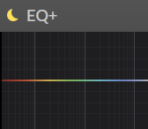
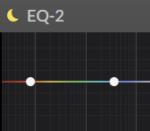
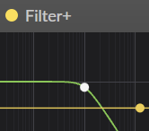
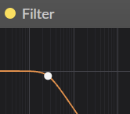
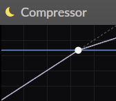
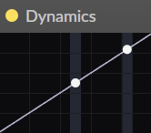
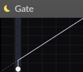
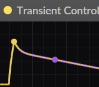
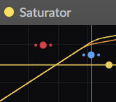
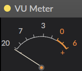

# Cimm's Bitwig mods

Mods for Bitwig Studio's interface, loaded with BML and managed in Patchbay.
For macOS. Each download works on both Bitwig Studio 6.1.4 and 6.1.7: the mods are built
against 6.1.4 and Patchbay adapts them to the installed version when they load.

## Mods

| Mod | What it does | Download |
| --- | --- | --- |
| [Mixer: Device Mini Panels](https://github.com/cimmmusic/bitwig-mods/tree/perf/mixer-device-mini-panels) | A small graphical view under each device in the mixer's Devices section (EQs, dynamics, filters, Tool and more) that you drag to adjust, plus live meters, including a mini [VU Meter](https://github.com/cimmmusic/bitwig-devices/tree/main/devices/cimm-vu). | [zip](https://github.com/cimmmusic/bitwig-mods/releases/download/downloads/mixer-device-mini-panels.zip) |
| [Mixer: VCA](https://github.com/cimmmusic/bitwig-mods/tree/vca/mixer-vca) | VCA faders: one fader moves a set of channels' faders together, with mute and solo for the group. | [zip](https://github.com/cimmmusic/bitwig-mods/releases/download/downloads/mixer-vca.zip) |
| [Pin Channels](https://github.com/cimmmusic/bitwig-mods/tree/pin/pin-channels) | Pin channels (VCAs, buses, a reference track) so they stay in view in a fixed bar in the arranger and mixer. | [zip](https://github.com/cimmmusic/bitwig-mods/releases/download/downloads/pin-channels.zip) |
| [VU Meter](https://github.com/cimmmusic/bitwig-devices/tree/main/devices/cimm-vu) | **Not a mod: a native Nitro device**, kept in [bitwig-devices](https://github.com/cimmmusic/bitwig-devices). Stereo needle VU meter with VU, PPM and RMS ballistics; Device Mini Panels shows it as a live mini meter in the mixer. | [Bitwig 6.1.7](https://github.com/cimmmusic/bitwig-devices/releases/download/downloads/VU-Meter-macos-6.1.7.zip) · [Bitwig 6.1.4](https://github.com/cimmmusic/bitwig-devices/releases/download/downloads/VU-Meter-macos-6.1.4.zip) |

All downloads: [Releases](https://github.com/cimmmusic/bitwig-mods/releases/tag/downloads).

## Mini views

What [Mixer: Device Mini Panels](https://github.com/cimmmusic/bitwig-mods/tree/perf/mixer-device-mini-panels) shows under each device in the mixer. Drag the dots to adjust the device.

<table>
  <tr><td></td><td></td><td></td><td></td></tr>
  <tr><td></td><td></td><td></td><td></td></tr>
  <tr><td></td><td></td><td></td><td></td></tr>
  <tr><td></td><td></td><td></td><td></td></tr>
</table>

Native devices live in [bitwig-devices](https://github.com/cimmmusic/bitwig-devices).
