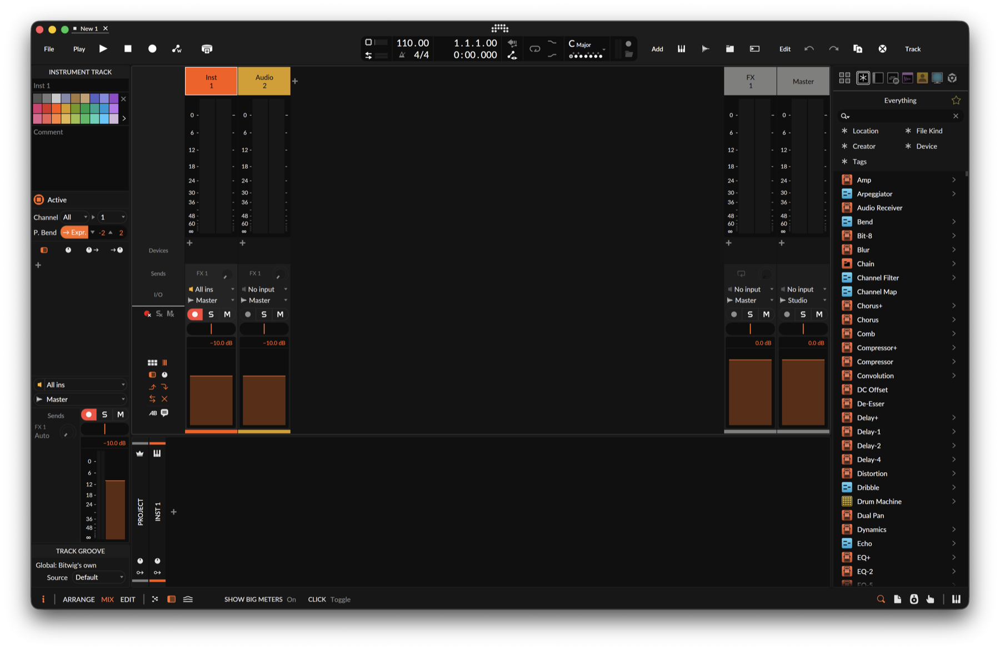
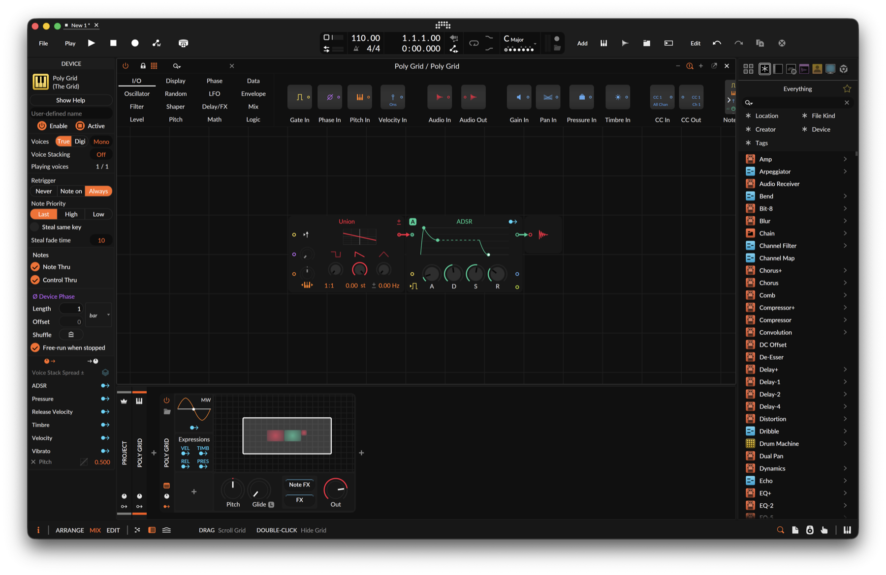
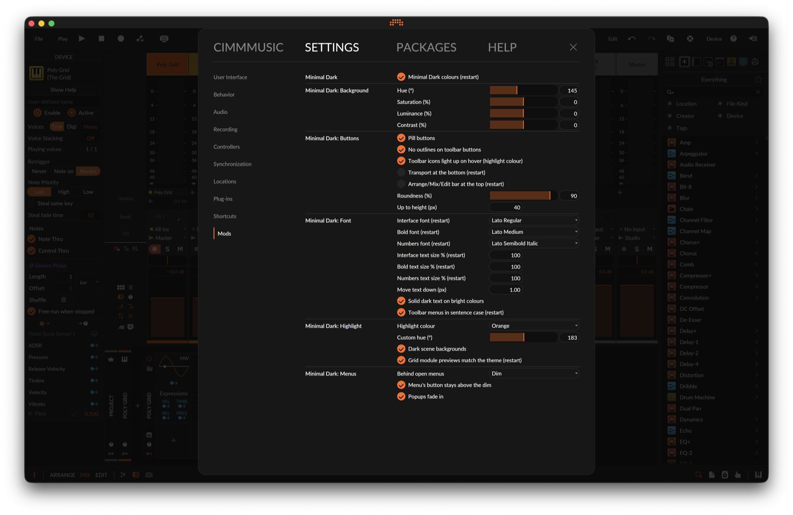
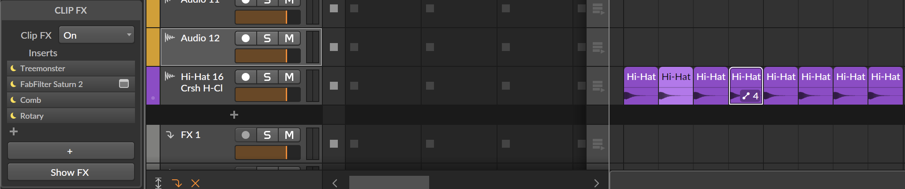
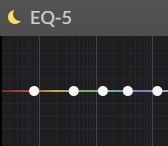
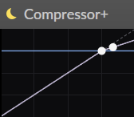
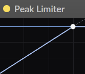
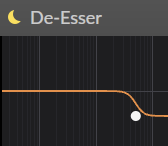
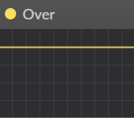
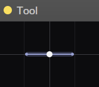

# Cimm's Bitwig mods

Mods for Bitwig Studio's interface, loaded with BML and managed in Patchbay.
For macOS. Each download works on both Bitwig Studio 6.1.4 and 6.1.7: the mods are built
against 6.1.4 and Patchbay adapts them to the installed version when they load.

## Mods

| Mod | What it does | Download |
| --- | --- | --- |
| [Clip: Clip FX](https://github.com/cimmmusic/bitwig-mods/tree/clip-fx/clip-fx) | **Arrangement only, beta.** Effects on a single arranger clip, like Studio One's Event FX: turn on Clip FX in the Inspector and add effects that only that clip plays through, with tails ringing out. The effects list works like the mixer's (drag to reorder); the effects are saved with the project and go when the clip is deleted. Beta: dragging clips is the least tested part (a clip dragged to another track loses its effects), so save first and see its page. | [zip](https://github.com/cimmmusic/bitwig-mods/releases/download/downloads/clip-fx-0.1.1.zip) |
| [Mixer: Device Mini Panels](https://github.com/cimmmusic/bitwig-mods/tree/perf/mixer-device-mini-panels) | A small graphical view under each device in the mixer's Devices section (EQs, dynamics, filters, Tool and more) that you drag to adjust, plus live meters, including a mini [VU Meter](https://github.com/cimmmusic/bitwig-devices/tree/main/devices/cimm-vu) (to see it, install the VU Meter Nitro device). | [zip](https://github.com/cimmmusic/bitwig-mods/releases/download/downloads/mixer-device-mini-panels-0.3.0-dev.1.zip) |
| [Mixer: VCA](https://github.com/cimmmusic/bitwig-mods/tree/vca/mixer-vca) | VCA faders: one fader moves a set of channels' faders together, with mute and solo for the group. | [zip](https://github.com/cimmmusic/bitwig-mods/releases/download/downloads/mixer-vca-0.1.0-dev.1.zip) |
| [Mixer: Pin Channels](https://github.com/cimmmusic/bitwig-mods/tree/pin/pin-channels) | Pin channels (VCAs, buses, a reference track) so they freeze at the top of the arranger, Excel-style, while the other tracks scroll under them. Mixer support to come. | [zip](https://github.com/cimmmusic/bitwig-mods/releases/download/downloads/pin-channels-0.1.0-dev.1.zip) |
| [Theme: Minimal Dark](https://github.com/cimmmusic/bitwig-mods/tree/minimal-theme/minimal-dark) | 🌑 **A whole new look for Bitwig, in one mod.** Flat near-black theme, the Lato font (included), pill buttons, a highlight colour of your choice, background hue/saturation/luminance/contrast sliders with text that flips black or white to stay readable, a cinema-style dim behind open menus, fading popups, a mint loop icon and loop range when looping, toolbar icons that light up on hover, and options to move the transport to the bottom or Arrange/Mix/Edit to the top. No Framework: Themes needed. | [zip](https://github.com/cimmmusic/bitwig-mods/releases/download/downloads/minimal-dark-0.1.0-dev.10.zip) |
| [Transport: Global Groove Files](https://github.com/cimmmusic/bitwig-mods/tree/groove/global-groove) | [.agr](https://github.com/cimmmusic/bitwig-mods/tree/groove/global-groove) and MIDI groove files, and a hand-drawn Manual groove graph, in Bitwig's own global Groove (Play menu): every note clip and sliced audio clip plays with it, without changing your notes. Single notes, clips, tracks and audio events can have a groove of their own (Inspector), marked with a white corner. Groove panel, Quantize window tabs and a note right-click menu to commit a groove; settings saved per project. | [zip](https://github.com/cimmmusic/bitwig-mods/releases/download/downloads/global-groove-0.10.1.zip) |
| [VU Meter](https://github.com/cimmmusic/bitwig-devices/tree/main/devices/cimm-vu) | **Not a mod: a native Nitro device**, kept in [bitwig-devices](https://github.com/cimmmusic/bitwig-devices). Stereo needle VU meter with VU, PPM and RMS ballistics; Device Mini Panels shows it as a live mini meter in the mixer. | [Bitwig 6.1.7](https://github.com/cimmmusic/bitwig-devices/releases/download/downloads/VU-Meter-macos-6.1.7.zip) · [Bitwig 6.1.4](https://github.com/cimmmusic/bitwig-devices/releases/download/downloads/VU-Meter-macos-6.1.4.zip) |

All downloads: [Releases](https://github.com/cimmmusic/bitwig-mods/releases/tag/downloads).

## Minimal Dark 🌑

Bitwig with the lights turned down and the good bits turned up: flat, near-black and quiet, so your music is the loudest thing on screen. One download, one tick in Patchbay, one restart. [Full tour on its page](https://github.com/cimmmusic/bitwig-mods/tree/minimal-theme/minimal-dark).

<table>
  <tr>
    <td></td>
    <td></td>
  </tr>
  <tr>
    <td></td>
    <td></td>
  </tr>
</table>

## Clip FX

**Arrangement only, beta.** Turn on Clip FX for an arranger clip in the Inspector, and its effects play only while that clip plays.

## Mini views

What [Mixer: Device Mini Panels](https://github.com/cimmmusic/bitwig-mods/tree/perf/mixer-device-mini-panels) shows under each device in the mixer. Drag the dots to adjust the device. To see the VU Meter view, install the [VU Meter Nitro device](https://github.com/cimmmusic/bitwig-devices/tree/main/devices/cimm-vu).

<table>
  <tr><td></td><td></td><td></td><td></td></tr>
  <tr><td></td><td></td><td></td><td></td></tr>
  <tr><td></td><td></td><td></td><td></td></tr>
  <tr><td></td><td></td><td></td><td></td></tr>
</table>

Native devices live in [bitwig-devices](https://github.com/cimmmusic/bitwig-devices).
