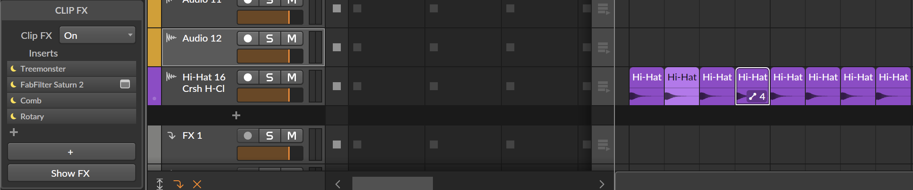

# Clip FX

Effects for a single clip, like Studio One's Event FX. Select a clip in the arranger, turn on **Clip FX** in the Inspector, and add effects that only that clip plays through. The rest of the track stays dry, and effect tails (reverb, delay) ring out after the clip ends.

**Arrangement only, and in beta.** Clip FX works on clips in the Arranger, not in the Clip Launcher. A couple of things don't work properly yet (dragging clips and Undo after deleting a clip): see **Known limits** below, and save before you rearrange.

## Using it

1. Select an arranger clip.
2. In the Inspector's **Clip FX** block, set **Clip FX** to **On**.
3. Click **+** to add effects with Bitwig's own browser.

The effects list works like the mixer's device list:
- click an effect to select it;
- double-click it to open it;
- drag it up or down to change the order;
- right-click it, or press Backspace, to remove it.

**Show FX** opens the clip's effects in the device panel. Set **Clip FX** to **Off** to bypass them; your effects are kept.

### What happens to your clips

- **Moving a clip:** drag it along the same track and its effects move with it. See **Dragging clips: take care** below.
- **Renaming a clip:** its effects follow the new name.
- **Deleting a clip:** its effects are removed too, so nothing keeps running in the background.
- **Saving:** Clip FX is saved with the project.

## How it works

Each clip with Clip FX gets its own effects device on its track, called **Clip FX – ⟨clip name⟩**. It's an FX Layer with a dry layer and an FX layer. The clip's own automation switches between them, so the effects play only while the clip plays.

These devices are hidden from the track's device chain and from the mixer: you see the effects in the Inspector, where the clip is. The settings are kept in a hidden block in the master track's comment.

## Known limits

> [!CAUTION]
> - **Arrangement only.** Clips in the Clip Launcher and single audio events aren't supported.
> - **Copy and paste:** a pasted clip plays through the **same** effects as the original.
> - **Undo after deleting a clip:** may not bring the clip's effects back. This is being worked on.

### Dragging clips: take care

> [!CAUTION]
> Dragging Clip FX clips is the least tested part of this beta, so save before rearranging. When you drag a clip, Bitwig deletes it and creates a new copy at the new spot. The mod then has to work out that the copy is the same clip, or it treats the move as a delete.
>
> - **Along the same track:** the clip should keep its effects, and the switching automation moves with it. This works from 0.1.0 on, but hasn't been tested much: earlier test versions lost the effects or crashed Bitwig's audio engine when a clip was dragged.
> - **To another track:** the clip **loses its effects**, which are removed as if it had been deleted. They can't follow it yet.
> - **Two clips with the same name and length on one track:** when you drag one of them, the effects can end up on the other one. Give the clips different names to be safe.
>
> **If a dragged clip loses its effects:** press **Undo** straight away. Or turn **Clip FX** off and on again on the clip, then add its effects back.

*Requires the Patchbay Mod Loader (BML), the Inspector framework and the Action Menu framework. An unofficial mod, not made or supported by Bitwig.*
