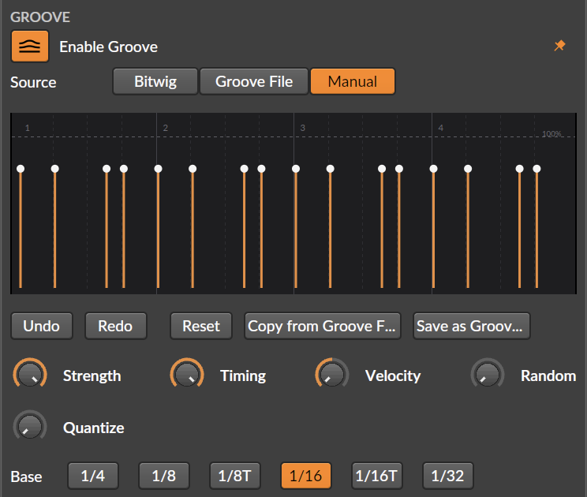

# Global Groove Files

.agr groove files and MIDI files in Bitwig's own global Groove, plus a Manual groove you draw yourself.

 

## Using it

- Open the Play menu. Under Enable Groove, set Source to Groove File.
- Browse… to load one or more .agr files (both .agr formats work) or MIDI files (.mid): every note-on becomes a groove hit, with its velocity; up to 16 bars, 4/4. The name field lists every loaded groove; the arrows step through them while playing.
- Every note clip plays with the groove, as with Bitwig's Shuffle, and so do sliced or consolidated audio clips (each audio hit moves with its step). Your notes and audio are never moved: turn Enable Groove off, or set Source back to Bitwig, and everything plays as written.
- The groove settings are saved in the project (with Bitwig's own Undo / Redo); a new project starts from the defaults. Each open project tab keeps its own groove.

## Manual

- Set Source to Manual to draw a groove by hand: one bar, a line per Base step.
- Drag a node left or right to play that step earlier or later (up to half a step), up or down for its velocity. It snaps to straight, ±25 %, ±50 % and to the 100 % velocity line; hold Shift for fine moves without snapping. Drag a box to select several nodes and move them together. Double-click or right-click > Reset to put a node back.
- Reset straightens the bar; Copy from Groove File starts it from the selected groove file.
- Save as Groove… writes the drawing as an .agr file (in Desktop/Grooves/Custom by default) and adds it to the Groove File list.
- Manual keeps its own knob settings and drawing for each Base.

## Groove panel

- The Groove button in the bottom bar opens the Manual graph as a panel (a lower-panel tab, or in the view stack with Panel: Streamlined Views): drag its edge to make it as big as you like; right-click the button for its scale.
- Under the graph: Use Manual, Undo, Redo, Reset, Copy from Groove File, Save as Groove… and the Base. It edits the same groove as the Play menu.

## Right-click on notes: Groove

Select notes, right-click, Groove:

- Apply Groove File to Notes / Apply Manual Groove to Notes: writes the groove into the notes themselves (timing and velocity; lengths are kept), with that source's knob settings, as one Undo step. Useful to commit a groove, or to groove only some notes.
- Extract Groove to Manual Graph: takes the selected notes' timing and velocity into the Manual graph (each step: the average of the notes nearest it, across the bars selected).
- Extract Groove and Save as .agr…: the same, then saves it as a groove file.

The Quantize… window has the same as tabs: Quantize (Bitwig's own), Groove File and Manual; OK commits the selected tab's groove to the selected notes.

Needs Framework: Actions and Menus, Framework: Piano Roll and Framework: Panels.

## Controls

- Strength: how much of the groove is used overall.
- Timing: how far notes move to the groove's timing.
- Velocity: how much the groove's accents change velocities (negative inverts them).
- Random: extra timing variation, the same on every play.
- Quantize: pulls notes to the Base grid before the groove is applied.
- Base: the grid the groove is measured on. Loading a groove sets these from the file; Strength stays.
- Double-click a knob to set it back to its default (shown in its value popup).

## Notes

- While a groove file or Manual is used, Bitwig's own Shuffle and Accent are paused (their settings are kept).
- Audio: each audio event moves as a whole with the groove (best on sliced or consolidated hits). One long audio event (a whole loop longer than a bar) is not stretched to the groove yet.
