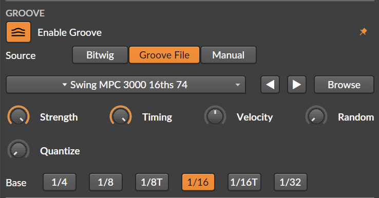
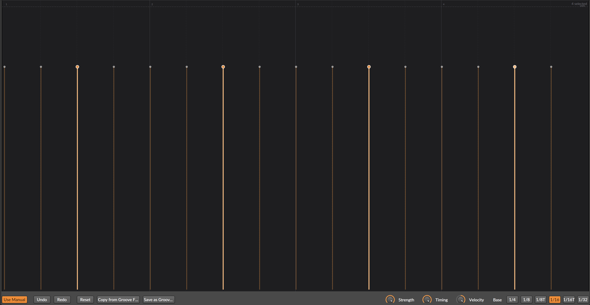

# Global Groove Files

**Bring the groove of an MPC, an Ableton .agr file or any MIDI file into Bitwig's own global Groove, or draw your own.**

Global Groove Files adds two new sources to Bitwig's Groove (Play menu): **Groove File** and **Manual**. Load .agr grooves or MIDI files, step through them while the track plays, or draw a one-bar groove by hand, step by step. Every note clip in the project plays with it, and so do sliced and consolidated audio clips. Your notes are never moved: switch the source back to Bitwig, or turn Enable Groove off, and everything plays exactly as written.

- **Groove files:** .agr (both formats) and MIDI (.mid), up to 16 bars. Each note becomes a groove hit, with its timing and velocity.
- **Manual groove:** drag each step earlier, later, louder or softer, with snapping to straight, ±25 % and ±50 %. Save it as an .agr file to reuse anywhere.
- **Strength, Timing, Velocity, Random and Quantize** knobs, and a Base from 1/4 to 1/32 (triplets included).
- **What you hear is what you get:** playback, MIDI recording and bounces all follow the same groove. Bitwig's own Shuffle and Accent are set to 0 while a groove file or Manual is in use, and come back when you switch to Bitwig.
- **Saved with the project**, with Bitwig's Undo / Redo. Each open project keeps its own groove.
- **A resizable Groove panel** for drawing the Manual groove at full size.
- **A groove of their own for single notes, clips, tracks and audio events**, set in Bitwig's Inspector, marked with a white corner, kept when copied and saved with the project.
- **macOS and Windows:** Browse and Save as Groove… open the system's own file dialogs on each (Linux: zenity or kdialog). Developed and tested on macOS; on Windows, please report anything that behaves differently.

*Requires the Patchbay Mod Loader (BML). An unofficial mod, not made or supported by Bitwig.*

 

## Using it

- Open the Play menu. Under Enable Groove, set Source to Groove File.
- Browse… to load one or more .agr files (both .agr formats work) or MIDI files (.mid): every note-on becomes a groove hit, with its velocity; up to 16 bars, 4/4. The name field lists every loaded groove; the arrows step through them while playing.
- Every note clip plays with the groove, as with Bitwig's Shuffle, and so do sliced or consolidated audio clips (each audio hit moves with its step). Your notes and audio are never moved: turn Enable Groove off, or set Source back to Bitwig, and everything plays as written.
- The groove settings are saved in the project (with Bitwig's own Undo / Redo); a new project starts from the defaults. Each open project tab keeps its own groove.

## Notes, clips, tracks and audio events

Select notes, a clip (arranger or launcher), a track, or audio events inside an audio clip, and the Inspector shows a **Groove** block at its end:

- **Source:** Default (follow the clip, track or global groove), Off (play straight), Groove File, or Manual A–D.
- **Groove**, **Strength, Timing, Velocity, Random, Quantize** and **Base**, as in the Play menu, for that selection only.
- The first line says what the selection plays with now, e.g. "Global: Tempest 16 Swing 60" or "From track: Manual B".
- Order: a note's own groove wins over its clip's, the clip's over its track's, the track's over the global groove. It applies whether the global Enable Groove is on or off.
- Notes, clips and audio events with a groove of their own get a **white corner** (hollow when set to Off).
- Copy, paste, duplicate or Alt-drag a note or clip and the copy keeps its groove.
- Saved with the project, and followed by Bitwig's Undo / Redo.
- Audio: separate audio events move as a whole; consolidated audio moves its hits through its warp markers.
- Bitwig's own Shuffle never adds to these: a clip that plays a groove of its own (or holds notes or audio events with one) has its Shuffle kept off towards the audio engine. The clip's Shuffle switch in the project stays as you set it.

## Manual

- Set Source to Manual to draw a groove by hand: one bar, a line per Base step.
- Four drawings, **A–D**. **Edit [A][B][C][D]** (Play menu and Groove panel) picks the drawing you work on; **Manual [A][B][C][D]** next to the Source buttons picks the one the global groove plays. Draw B, C and D for notes, clips and audio events while the global groove stays on A.
- Drag a node left or right to play that step earlier or later (up to half a step), up or down for its velocity. It snaps to straight, ±25 %, ±50 % and to the 100 % velocity line; hold Shift for fine moves without snapping. Drag a box to select several nodes and move them together. Double-click or right-click > Reset to put a node back.
- Reset straightens the bar; Copy from Groove File starts it from the selected groove file.
- Save as Groove… writes the drawing as an .agr file (in Desktop/Grooves/Custom by default) and adds it to the Groove File list.
- Manual keeps its own knob settings and drawing for each Base.

## Groove panel

- The Groove button in the bottom bar (, the orange one) opens the Manual graph as a panel (a lower-panel tab, or in the view stack with Panel: Streamlined Views): drag its edge to make it as big as you like; right-click the button for its scale.
- Under the graph: Use Manual, Undo, Redo, Reset, Copy from Groove File, Save as Groove… and the Base. It edits the same groove as the Play menu.

## Right-click on notes: Groove

Select notes, right-click, Groove:

- Apply Groove File to Notes / Apply Manual Groove to Notes: writes the groove into the notes themselves (timing and velocity; lengths are kept), with that source's knob settings, as one Undo step. Useful to commit a groove, or to groove only some notes.
- Extract Groove to Manual Graph: takes the selected notes' timing and velocity into the Manual graph (each step: the average of the notes nearest it, across the bars selected).
- Extract Groove and Save as .agr…: the same, then saves it as a groove file.

The Quantize… window has the same as tabs: Quantize (Bitwig's own), Groove File and Manual; OK commits the selected tab's groove to the selected notes.

Needs Framework: Actions and Menus, Framework: Piano Roll and Framework: Panels.

## Controls

- Strength: how much of the groove is used overall.
- Timing: how far notes move to the groove's timing.
- Velocity: how much the groove's accents change velocities (negative inverts them).
- Random: extra timing variation, the same on every play.
- Quantize: pulls notes to the Base grid before the groove is applied.
- Base: the grid the groove is measured on. Loading a groove sets these from the file; Strength stays.
- Double-click a knob to set it back to its default (shown in its value popup).

## Notes

- While a groove file or Manual is used, Bitwig's own Shuffle and Accent are set to 0, so they never add to the groove (in playback, recording or bounces). Your own values are kept with the project and come back when Source is set to Bitwig; Undo covers both.
- Audio: each audio event moves as a whole with the groove (best on sliced or consolidated hits). One long audio event (a whole loop longer than a bar) is not stretched to the groove yet.
