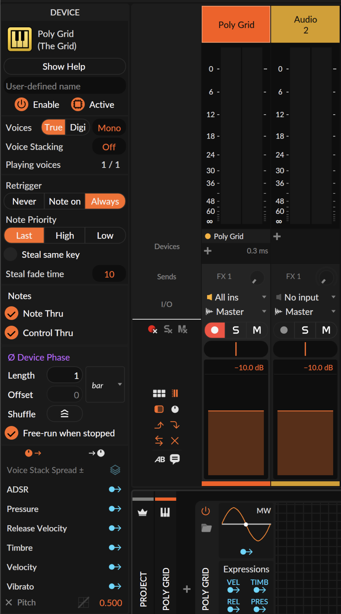

# Theme: Minimal Dark 🌑

**Bitwig, with the lights turned down and the good bits turned up.**

Minimal Dark is a whole new coat of paint for Bitwig Studio, in **one mod**. Not a theme file plus a font mod plus a colour mod plus a button mod plus three frameworks taped together: one download, one tick in Patchbay, one restart, done. ☕

It's near-black, flat and quiet, so your music is the loudest thing on screen. And when you open a menu, everything behind it politely dims, like a cinema when the film starts. 🍿

---

## What you get

### 🎨 A flat, near-black theme
- **Near-black, everywhere.** Panels, fields, menus and the toolbar sit in a tight family of very dark greys (#101010 to #242424), so nothing shouts.
- **Flat means flat.** No gradients, no button outlines, no drop shadows, no embossed knobs. Bitwig's derived "slightly lighter, slightly darker" shades are switched off too, so every surface is exactly one colour.
- **Crisp white text and icons**, with hairline separators and **one accent colour** for whatever's on, armed or playing.
- **Your track and clip colours stay yours.** The theme only repaints Bitwig, never your music.
- **Loop in mint.** When the loop is on, the transport's loop icon and the loop range in the timeline glow mint green; when it's off, they sit quietly in grey. 🟢
- The little corner arrows on the File / Play / Add menus are gone. You knew they were menus. 😉

### 🔤 Lato, included
- Ships with the **Lato** family (SIL Open Font License, see `lato/OFL.txt`), so it looks the same on every Mac. No installing fonts.
- **Lato Regular** for the interface, **Lato Medium** for bold text, and **Lato Semibold Italic** for numbers (tempo, position, dB, knob values), so numbers stand out from labels.
- Prefer something else? Pick **any font on your Mac**, or drop your own `.ttf`/`.otf` into the mod's `fonts` folder. The font picker is a proper scrollable list with a search field, and every name is drawn in its own font. 🔍
- Separate text sizes for interface, bold and numbers, plus a **move text down** nudge for fonts that sit high in Bitwig's fields.
- **Sentence case everywhere.** "File, Play, Add" in the toolbar, "Settings, Packages, Help" on the Dashboard, "Instrument track", "Track groove", "Drag", "Double-click"... instead of Bitwig's capitals. Acronyms like MIDI, FX and LFO stay as they are, and every label keeps Bitwig's exact size and spacing. Bitwig has stopped shouting. 🤫
- **Solid dark text on bright colours.** Black text on an orange track tile is drawn properly solid, instead of thin light strokes that read as brown.

### 🎭 26 Looks, one click
Not sure where to start? The **Look** dropdown (top of the Minimal Dark settings) sets the background tone *and* the highlight colour in one go, and the whole window follows instantly, arrangement and scenes included:

**Minimal Dark** · Midnight Blue · Aubergine · Forest · Espresso · Graphite · Ocean · Bordeaux · Slate · Moss · Teal Night · Plum · Indigo · Sand · Rosewood · Neon · Arctic · Ember · Lagoon · Lavender · Olive · Cobalt · Mocha · Emerald · Crimson · Storm

Tweak any slider afterwards and it simply becomes your own **Custom** look. Minimal Dark itself stays pure neutral near-black.

### 💡 Pick your highlight colour
- Orange out of the box, or choose **Red, Pink, Purple, Violet, Blue, Cyan, Mint, Green, Lime, Yellow, White**, or **any custom hue** you like.
- Everything Bitwig draws in its accent follows: toggles, LEDs, knob values, number-field bars, beat markers, drop indicators, comp fills, the start/end markers and the locked-device overlay.

### 🌈 Background tone: make it yours
Want a midnight-blue Bitwig? A deep purple one? Sliders for the whole background:
- **Hue**, **Saturation**, **Luminance** and **Contrast**, applied live as you drag. No restart.
- **Text looks after itself** (accessibility built in ♿):
  - Push the background light, and the text flips to **black**; keep it dark, and it stays **white**.
  - On coloured clips and tracks, text is **black or white, whichever contrasts more**, using the WCAG contrast maths rather than a guess.
  - Error and notification text stays readable on whatever background you pick.
- **Double-click any of the four sliders** to snap straight back to the default dark look. Panic button included. 🚨

### ⬭ Pill buttons and a tidy toolbar
- **Pill-shaped buttons**, with a **Roundness** slider (0% square to 100% full pill) and a height limit so big panels don't turn into giant capsules.
- **No outlines on the toolbar buttons**: just the icons, floating cleanly.
- **Toolbar icons light up on hover** in your highlight colour. The **record button glows red**, because some things are sacred. 🔴
- **Move things around** (restart to apply):
  - put the **transport at the bottom** of the window;
  - put the **Arrange / Mix / Edit bar at the top**;
  - or do both and flip Bitwig upside down. 🙃

### 🌘 Menus that take the spotlight
- **Dim behind open menus.** Open any menu and the window behind it fades down (in Bitwig's own popup-overlay colour) and fades back up when you're done. Meters and all go under it: nothing pokes through.
- **The menu's own button stays lit** above the dim, so you can always see which menu you opened ("File", glowing in your highlight colour).
- **Popups fade in**, smoothly, instead of slamming onto the screen (macOS).
- Tooltips and hover popups don't dim anything. That would be exhausting. 😵‍💫

### ✨ Little touches
- **Dark scene backgrounds** in the clip launcher, instead of grey slabs (tinted with your look).
- **A calmer Dashboard**: centred in the window with breathing room above and below, instead of running top to bottom.
- **Notifications dot** (top right): grey while notifications are hidden, mint while they're shown.
- **Grid module previews match the theme**: the module thumbnails in the Grid's browser are re-toned to the dark look, so they finally match the real modules.

---

## Install

1. Download **[minimal-dark-0.2.0-dev.10.zip](https://github.com/cimmmusic/bitwig-mods/releases/download/downloads/minimal-dark-0.2.0-dev.10.zip)** and add it in **Patchbay** (or unzip it into BML's `mods` folder).
2. Tick **Theme: Minimal Dark**.
3. Press **Load** / restart Bitwig. That's it. 🎉

**Coming from the separate mods?** Minimal Dark contains Interface: Font, Highlight & Background, Menu Backdrop and Pill Buttons, so switch those off. It also doesn't need **Framework: Themes**: if that framework is on with another theme selected, Minimal Dark politely leaves the colours to it and still does everything else. To see Minimal Dark's own colours, turn Framework: Themes off (or select no theme in it).

## Settings

Everything lives in **Settings › Mods**, in the sections starting with **"Minimal Dark"**:

| Section | What's there |
| --- | --- |
| **Minimal Dark** | Look (26 presets), theme colours on/off *(restart)* |
| **Background** | Hue, Saturation, Luminance, Contrast. Double-click a slider to reset all four. |
| **Buttons** | Pill buttons, no toolbar outlines, hover icons, transport at the bottom *(restart)*, Arrange/Mix/Edit bar at the top *(restart)*, Roundness, Up to height |
| **Font** | Interface / Bold / Numbers font *(restart)*, their text sizes *(restart)*, Move text down, Solid dark text on bright colours, Sentence case instead of capitals *(restart)* |
| **Highlight** | Highlight colour, Custom hue, Dark scene backgrounds, Grid module previews *(restart)* |
| **Menus** | Behind open menus (Dim / Off), Menu's button stays above the dim, Popups fade in |

## Tinkering 🛠️

- **Change any colour:** edit `theme/minimal-dark.bte` in the mod's folder. It's the Bitwig Theme Editor format (`Name: #RRGGBB` or `#RRGGBBAA`, one per line), then restart Bitwig.
- **Swap icons:** put an `.svg`/`.png` with the same name as Bitwig's in `theme/overlays/icons` (or `images`), then restart.
- **Your own fonts:** drop them in the mod's `fonts` folder and they appear at the top of the font list.

## Good to know

- **macOS**, built for Bitwig Studio **6.1.4 and 6.1.7** (BML adapts it on load). **Windows:** it should load (since 0.1.0-dev.11) but hasn't been tested there yet; popups don't fade in on Windows. Reports welcome!
- Some changes need a **restart** (marked *(restart)* in Settings). Background, highlight and menu changes apply live.
- If something looks off, Bitwig's log (`~/Library/Logs/Bitwig/BitwigStudio.log`) has a `[minimal-dark]` line for each part as it kicks in. Send it over! 📬

## Credits

- **Lato** by Łukasz Dziedzic (tyPoland), under the SIL Open Font License 1.1: see `lato/OFL.txt`.
- The theme-file format is the one from Berikai's **Bitwig Theme Editor**, so `.bte` files you've made there can be pasted in.
- Made by **Cimm**, for anyone who likes their DAW like their coffee. ☕🖤
