# Mixer: Device Mini Panels

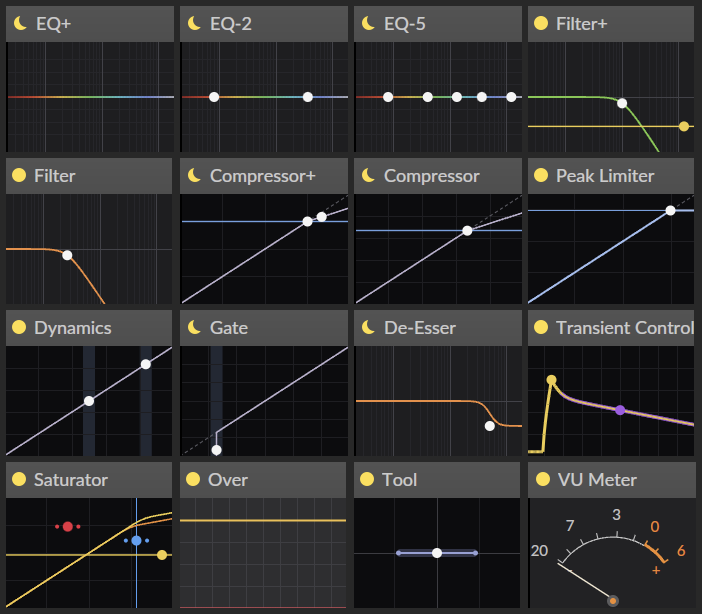

Give your mixer X-ray vision. Device Mini Panels puts a tiny picture of **16 devices** right under their names in the mixer: EQ curves, compressor knees, filter slopes, saturation, transients and even a swinging VU needle. Spot what every channel is doing at a glance, then grab a dot and drag to shape the sound, without opening a single device window.

## The 16 devices

- **EQ:** EQ+, EQ-5, EQ-2
- **Filters:** Filter+, Filter, De-Esser
- **Dynamics:** Compressor+, Compressor, Dynamics, Gate, Peak Limiter, Transient Control
- **Colour:** Saturator, Over
- **Utility:** Tool
- **Meter:** VU Meter (needs the VU Meter Nitro device installed)

## Getting started

- Turn on the mixer's Devices section (the section toggles at the bottom of the mixer).
- Supported devices get a mini view under their name. Other devices keep Bitwig's normal row.
- Views are open in the mixer and collapsed in the track Inspector by default.

## Working with the views

- Drag a node to change the device's settings. Every drag is one undo step.
- Modulation shows as a see-through "ghost" of the curve and nodes that follows it live. The solid curve and nodes stay at the knob's own value.
- In the EQ and filter views the 0 dB centre line is sticky: it catches a node and only lets go when you pull it clearly away.
- Right-click a view for Collapse Mini View. A collapsed view becomes a thin bar; click it to open it again.
- Right-click a view (away from its nodes) for Reset Device to Default: every knob, choice and switch of the device goes back to its default.
- Right-click a device for Mini View in Mixer / Track Inspector: Collapse or Expand.
- Devices renamed by a preset are still recognised for most views.
- You can also hide unwated devices in the mixer view for a clean and visually aligned experience. 

## EQ+

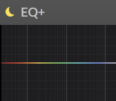

- Shows the frequency response with one node per band (up to 8 bands), in EQ+'s rainbow curve.
- Drag a node for frequency and gain (cuts and notches: frequency and Q).
- Click empty space to add a band; double-click a node to remove it.
- Scroll or middle-drag over a node for Q.
- Right-click a node for its band type.

 

## EQ-5

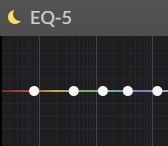

- Shows the frequency response with one node per band (up to 5 bands). Global Amount scales what's drawn.
- Drag a node for frequency and gain (cuts and notches: frequency and Q).
- Click empty space to add a band; double-click a node to remove it.
- Scroll or middle-drag over a node for Q.
- Right-click a node for its band type.

 

## EQ-2

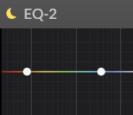

- Shows the frequency response with a node for the low and the high band.
- Drag a node for frequency and gain (cuts and notches: frequency and Q).
- Click empty space to add a band; double-click a node to remove it.
- Scroll or middle-drag over a node for Q.
- Right-click a node for its band type.

 

## Compressor+

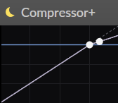

- Shows the transfer curve with its soft knee and a dashed 1:1 line.
- Drag the node at the bend for the threshold.
- Drag the knee node right/up to widen the knee, left/down to narrow it.

 

## Compressor

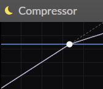

- Shows the transfer curve (hard knee) with a dashed 1:1 line, drawn like Compressor+.
- Drag the node at the bend for the threshold.
- Follows the device's Input knob (moves the bend) and Output knob (shifts the curve up or down).

 

## Dynamics

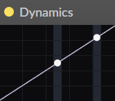

- Shows the transfer curve with both thresholds.
- Drag the low and high threshold nodes.

 

## Gate

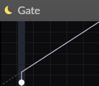

- Shows the transfer curve dropping below the threshold.
- Drag the node: left/right for Threshold, up/down for Depth.

 

## Peak Limiter

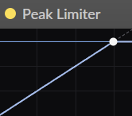

- Shows the 1:1 line bending into the ceiling.
- Drag the node: up/down for Ceiling, left/right for Input.

 

## Over

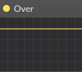

- Shows a scrolling waveform of the channel with the Clip line. Nothing is drawn above the line.
- Drag the line up or down for Clip.

 

## Saturator

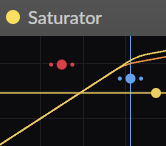

- Shows the device's curves, the Quiet and Loud nodes and a yellow Drive line.
- Drag the Quiet and Loud nodes for threshold and amount.
- Drag the yellow node up or down for Drive.

 

## Transient Control

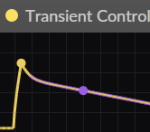

- Shows a drum hit before (dashed) and after (yellow attack, purple sustain).
- Attack node: up/down for Gain, left/right for Time.
- Sustain node: the same for Sustain.

 

## Filter

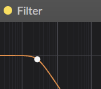

- Shows the filter response.
- Drag the node: left/right for Cutoff, up/down for Resonance.
- Right-click the node for the filter type.

 

## Filter+

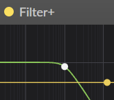

- Shows the filter response with a yellow Drive line.
- Drag the node as in Filter.
- Right-click the cutoff node for the filter module, or the yellow node for the waveshaper module.

 

## De-Esser

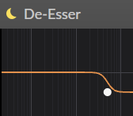

- Shows the cut above the frequency.
- Drag the node: left/right for Frequency, up/down for Amount.
- Right-click the node for the mode.

 

## Tool

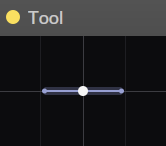

- Shows the stereo image as a bar.
- Drag the centre for pan and gain (centre pan is sticky); drag the ends for width.

 

## Meters and displays

<a href="https://github.com/cimmmusic/bitwig-devices/tree/main/devices/cimm-vu">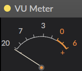</a>

- [VU Meter](https://github.com/cimmmusic/bitwig-devices/tree/main/devices/cimm-vu) (Cimm's native Nitro device): live needles.
  To see this meter, install the [VU Meter Nitro device](https://github.com/cimmmusic/bitwig-devices/tree/main/devices/cimm-vu) first. It isn't part of this mod.
- Oscilloscope, Spectrum, Tuner: Bitwig's own live display.

 

## Notes

- Curves follow the knobs, not the audio passing through. De-Esser and Transient Control show what they can do rather than what they're doing at that moment.
- Over's waveform is the channel's output level.
- Collapse choices last for the current session.
- Built for Bitwig Studio 6.1.4 / 6.1.7
